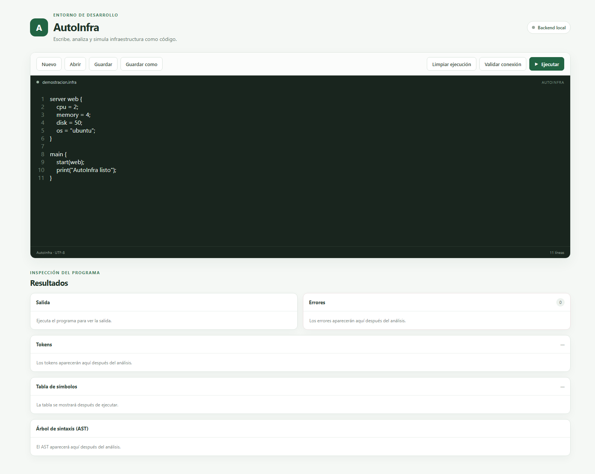
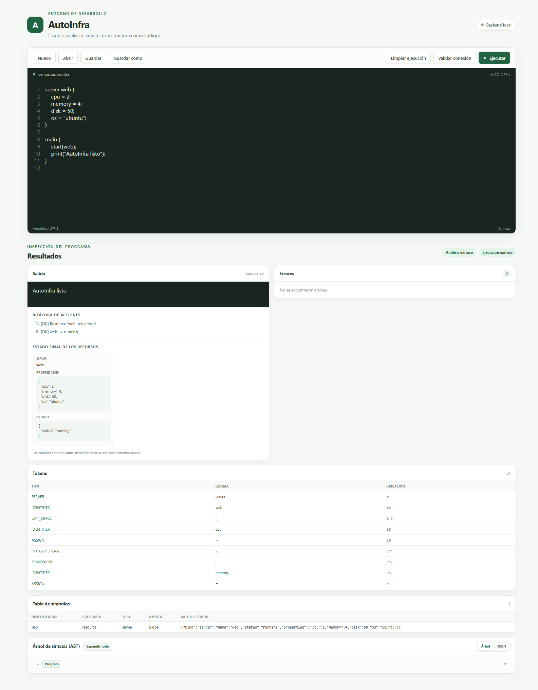

# Manual de usuario de AutoInfra

## 1. ¿Qué es AutoInfra?

AutoInfra es un entorno web para escribir archivos `.infra`, analizarlos y simular
acciones sobre recursos `server`, `service` y `database`. La simulación se realiza en
memoria: no se conecta a servidores ni modifica infraestructura real.

La pantalla presenta un editor y, debajo, reportes de salida, errores, tokens, tabla
de símbolos, AST y estado final de los recursos.

## 2. Iniciar el entorno

Se necesita Node.js 20.19 o superior y npm. Desde la carpeta del proyecto, abre dos
terminales:

**Terminal 1 — backend:**

```powershell
cd C:\Users\jimhu\Desktop\OLC1_Proyecto2_202303768\backend
npm install
npm run dev
```

El backend escucha en `http://localhost:8080`.

**Terminal 2 — frontend:**

```powershell
cd C:\Users\jimhu\Desktop\OLC1_Proyecto2_202303768\frontend
npm install
npm run dev
```

Vite escucha en `http://localhost:5173`. Abre esa dirección en el navegador. El
frontend reenvía las solicitudes `/api` al backend. Mantén ambas terminales abiertas
mientras utilizas la aplicación. Si el puerto 5173 ya está ocupado, cierra la otra
instancia del frontend antes de iniciar una nueva.



*Figura 1. Editor de código, acciones de archivo y paneles de resultados antes de
ejecutar.*

## 3. Crear un archivo

1. Pulsa **Nuevo**.
2. La aplicación limpia el resultado anterior, cambia el nombre visible a
   `sin-titulo.infra` y coloca un bloque `main` vacío en el editor.
3. Escribe el programa AutoInfra. El archivo debe terminar con un único bloque
   `main`.
4. Para un primer ejemplo, puedes usar:

   ```infra
   server web {
       cpu = 2;
       memory = 4;
       disk = 50;
       os = "ubuntu";
   }

   main {
       start(web);
       print("AutoInfra listo");
   }
   ```

## 4. Abrir un archivo `.infra`

1. Pulsa **Abrir**.
2. En el selector de archivos, busca el archivo `.infra` y selecciónalo.
3. El contenido se carga en el editor y el nombre aparece en la barra del archivo.
4. Si el archivo no tiene la extensión `.infra`, la aplicación agrega esa extensión
   al nombre mostrado.

El navegador solicita permiso para leer el archivo local seleccionado. El archivo no
se sube a un almacenamiento persistente del backend.

## 5. Guardar y Guardar como

- **Guardar** descarga el contenido actual usando el nombre que aparece en la barra
  del archivo. Si el nombre no termina en `.infra`, se añade la extensión.
- **Guardar como** permite indicar otro nombre y descarga una copia con ese nombre.
  La descarga utiliza el mecanismo normal del navegador y su carpeta de descargas.
- La aplicación no guarda automáticamente en la ruta original ni conserva archivos
  en una base de datos; para guardar cambios, utiliza los botones de descarga y
  selecciona la ubicación en el navegador si este lo solicita.

## 6. Ejecutar el programa

1. Revisa que el editor contenga el programa completo.
2. Pulsa **Validar conexión** si quieres comprobar que el backend responde. El
   indicador superior mostrará si el backend está conectado.
3. Pulsa **Ejecutar**.
4. La interfaz envía el texto del editor al endpoint `POST /api/execute`.
5. El backend realiza el análisis léxico, el análisis sintáctico y, si ambos pasan,
   recorre el AST para simular la ejecución.
6. Al terminar, la pantalla informa si el análisis y la ejecución fueron exitosos.


*Figura 2. Ejemplo cargado y listo para ejecutar.*

## 7. Consultar reportes

Los reportes aparecen debajo del editor:

- **Salida:** texto producido por `print`.
- **Bitácora de acciones:** recursos registrados y acciones simuladas, por ejemplo,
  iniciar, instalar, desplegar o escalar.
- **Estado final de los recursos:** una tarjeta por recurso, con sus propiedades y
  estado final simulado.
- **Errores:** errores léxicos, sintácticos, de ejecución o de infraestructura. Se
  muestran tipo, código cuando existe, descripción y ubicación.
- **Tokens:** tipo, lexema y posición de cada token.
- **Tabla de símbolos:** inventario de variables, parámetros, funciones, tareas y
  recursos observados durante la ejecución. Es un reporte, no una validación
  semántica.
- **Árbol de sintaxis (AST):** representación en árbol de los nodos generados por el
  backend. Se puede alternar entre la vista de árbol y JSON; en el árbol se pueden
  expandir o contraer los nodos.



*Figura 3. Reportes generados por la ejecución del ejemplo.*

## 8. Limpiar una ejecución

Pulsa **Limpiar ejecución** para retirar de la interfaz los resultados de la última
ejecución. Esto limpia la vista actual; no elimina archivos descargados ni genera
reportes persistentes.

Al editar el código, los resultados se limpian automáticamente para evitar confundir
un reporte anterior con el contenido actualizado.

## 9. Errores frecuentes

| Situación | Qué revisar |
| --- | --- |
| La página no abre | Comprueba que el frontend esté iniciado en el puerto 5173. |
| El indicador no conecta | Comprueba que el backend siga activo en el puerto 8080 y pulsa **Validar conexión**. |
| Vite informa que el puerto está ocupado | Cierra la instancia anterior del frontend y vuelve a iniciar `npm run dev`. |
| Error léxico | Revisa caracteres no reconocidos, cadenas, escapes y cierre de comentarios. |
| Error sintáctico | Revisa llaves, paréntesis, corchetes, punto y coma y la ubicación del bloque `main`. |
| Error durante ejecución | Consulta tipo, descripción, línea y columna en el panel de errores. |

Los archivos de prueba incluidos en `examples/` y el contrato HTTP están descritos
en [CONTRATO_API.md](./CONTRATO_API.md). La sintaxis se especifica en
[GRAMATICA_AUTOINFRA.md](./GRAMATICA_AUTOINFRA.md).
